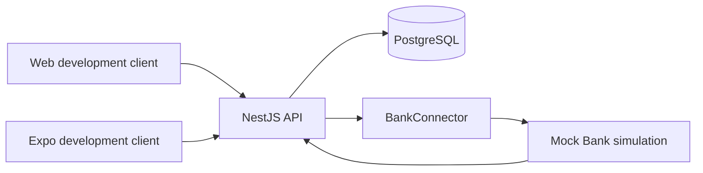
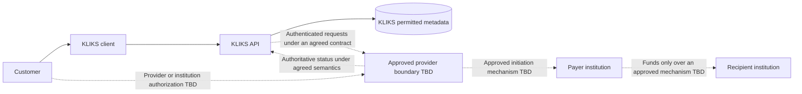

# Product and Payment Data Flow

**Status:** Internal description and proposal, not an approved legal or provider operating model.  
**Gate:** BLOCKED; see [evidence register](EVIDENCE_REGISTER.json).

## Proposed Product

KLIKS aims to let a customer identify a person or business by a verified alias or opaque QR reference, confirm the receiving identity and EUR amount, and authorize an account-to-account payment through an appropriate institution/provider. KLIKS would not hold funds, create stored-value balances, collect bank passwords, operate an invented rail, or represent itself as a bank. Whether any proposed interaction is legally permitted, and through which institution/authorization structure, remains unanswered.

| Area               | Implemented local simulation                                                         | Proposed external behavior requiring evidence                                                                                                                                                                                 |
| ------------------ | ------------------------------------------------------------------------------------ | ----------------------------------------------------------------------------------------------------------------------------------------------------------------------------------------------------------------------------- |
| Identity           | Synthetic identities and in-app development codes; local ID selection.               | Authentic KLIKS identity/authentication, recovery and provider customer mapping under reviewed responsibilities.                                                                                                              |
| Account connection | Mock Bank approve/reject/default/disconnect.                                         | Institution-supported account selection and consent, with verified account ownership and opaque references.                                                                                                                   |
| Discovery          | Explicit directory opt-in; verified development aliases; generic misses.             | Lawful alias enrollment, recipient binding, number-change/recycling and abuse safeguards accepted by the relevant parties.                                                                                                    |
| Payments           | Deterministic simulated initiation and payer-selected mock outcomes.                 | Provider-mediated initiation and institution authorization; authoritative status and recovery, never a client-selected outcome.                                                                                               |
| Requests/splits    | Persisted requests and exact participant allocations; separate authorization.        | Legally reviewed request/merchant scope; each payer still confirms and authorizes independently. No implied debt collection or custody.                                                                                       |
| QR                 | Opaque single-use sessions; reusable merchant references create temporary checkouts. | Approved destination binding, consent and security semantics; static QR is never itself authority to debit funds.                                                                                                             |
| Merchants          | Development roles and collection into an owner's Mock Bank account.                  | Valid legal business, authorized representatives, account ownership, permitted business account/beneficiary structure, onboarding and risk responsibilities. The mock owner-account model is not a real merchant arrangement. |
| Refunds            | Disabled with a stated reason.                                                       | Only a documented provider/operating process, if supported and approved. No fabricated reversal endpoint.                                                                                                                     |

A phone-verification flag is not KYC, a saved identity ID is not a credential, and a merchant display name is not business verification. Local directories or mock recipient checks must not be presented as institution-confirmed name/account matching.

## Current Architecture

Web (Next.js) and mobile (Expo) call the NestJS modular API. Identity, Directory, Banking, Payments, Requests, QR, Bills, Merchants and Audit use PostgreSQL through Prisma. Payments uses the BankConnector boundary, currently bound only to MockBankConnector. QR/bill/request transactions and audits use persistent constraints/idempotency; no external financial side effect exists.

Relevant implementation surfaces: [connector contract](../../apps/api/src/modules/banking/bank-connector.ts), [payment orchestration](../../apps/api/src/modules/payments/payments.service.ts), [database schema](../../packages/database/prisma/schema.prisma), and [architecture](../architecture/README.md).

## Proposed Data and Money Boundaries

This diagram is a discussion artifact. It does not assert that a provider supports the flow or that any shown rail, API, authorization method or direct participation is available to KLIKS.

No funds arrow enters KLIKS. A no-custody diagram is a product constraint, not proof of licensing exemption or regulatory classification. Actual institutional/settlement paths and intermediary responsibilities must be supplied by the partner.

## Proposed Customer Sequence

1. Authenticate a customer under an approved identity/access model. Reject supplied client identity IDs as bank-account authority. Enroll/link an eligible account through the genuine institution/provider consent process; store only agreed opaque references.
2. Resolve a lawful, opted-in alias or opaque request/QR reference server-side. Revalidate recipient identity/account binding and eligibility. Reject unknown, expired, consumed or unauthorized requests without leaking directory/account data.
3. Show the authoritative receiving identity, merchant context if relevant, EUR amount, supported fees/timing disclosures and selected source account. Request explicit customer confirmation. An earlier QR scan or bill invitation is not payment authorization.
4. Persist a scoped payment intent and idempotency/recovery context before the external side effect, using a design derived from the provider contract. The current mock transaction pattern must not be copied blindly around a network payment call.
5. Initiate through the documented authenticated provider boundary. Hand the payer to the approved authorization/SCA mechanism, if applicable. Bind any callback/session to the correct customer, consent, amount and recipient. Never collect bank credentials in KLIKS or place access secrets in URLs/QRs.
6. Interpret the provider response and subsequent authenticated status notifications/queries using agreed semantics. A redirect, HTTP success, request acceptance or initiation acknowledgement is not proof of settlement.
7. Display only supportable status. Preserve audit and correlation evidence without exposing bank/provider references through directory search. Record later corrections/reversals explicitly instead of rewriting a terminal record.
8. Revoke/disconnect/expire access according to the agreed contract, with a customer support and recovery route. Do not retain obsolete aliases or tokens merely because a local record remains.

## Failure and Recovery Paths

| Situation                                                      | Required question/control before real integration                                                                                           |
| -------------------------------------------------------------- | ------------------------------------------------------------------------------------------------------------------------------------------- |
| Timeout after provider submission                              | Query the same intent/provider reference and use documented retry rules; never assume failure or initiate a second payment blindly.         |
| Authorization return but no final status                       | Treat it as incomplete status evidence; recover using authenticated status sources.                                                         |
| Duplicate or out-of-order callback                             | Authenticate, correlate, deduplicate and apply valid transitions only. Acknowledge/retry semantics must be documented.                      |
| Provider accepted but institution later rejects/returns        | Use the provider's actual meaning and correction/dispute process; do not map every acceptance to SUCCEEDED.                                 |
| Recipient opt-out/account disconnect between review and submit | Revalidate according to the institution's contract and agreed privacy rules.                                                                |
| Stolen/recycled phone or compromised merchant staff account    | Review identity recovery, alias reassignment, revocation and beneficiary-change responsibilities; local phone verification is insufficient. |
| Provider outage or ambiguous finality                          | Define recovery ownership, user messaging, escalation and operational reporting before enabling the flow.                                   |

The current state enum has no general unknown-execution state. A real-provider mapping may require a reviewed design change; this package does not add states or assert that ambiguous execution can safely be marked FAILED.

## Data Inventory and Proposed Handling

All future collection/retention is conditional on PRIVACY-01 and SECURITY-01. No retention period or lawful basis is invented here.

| Data                                                                  | Current/proposed purpose                                     | Boundary and open issue                                                                                                                    |
| --------------------------------------------------------------------- | ------------------------------------------------------------ | ------------------------------------------------------------------------------------------------------------------------------------------ |
| Phone, username, internal identity ID                                 | Alias enrollment and discovery.                              | Opt-in, verification/reassignment, legal basis, minimization, access and deletion need review. Avoid raw phone data in logs/QRs.           |
| Account/consent references                                            | Link the authorized account and recover provider status.     | Opaque values only where possible; provider terms, ownership checks, access controls and retention remain unknown.                         |
| Provider access/refresh tokens, certificates or signing material      | Only if genuinely required by approved documentation.        | Server-side secret storage, rotation, revocation and least privilege; never Git, client local storage, QR, ordinary logs or model prompts. |
| Payment party IDs, minor-unit amount, currency, states and timestamps | Intent, customer status, audit and reconciliation.           | Separate authoritative provider status from internal workflow state; define permitted disclosure, retention and dispute evidence.          |
| Callback/session/correlation identifiers                              | Bind authorization and recover ambiguous outcomes.           | Unpredictability alone is not authorization. Prevent cross-user/tenant binding and replay.                                                 |
| Merchant profile, representatives and staff roles                     | Business onboarding and collection permissions.              | Mock roles/owner account are not legal business/account verification; require partner and legal agreement.                                 |
| Audit/security/operational records                                    | Explain access, intent, state changes and incident response. | Define tamper protection, access, minimization and retention; avoid credentials and unnecessary PII.                                       |
| QR/request/bill records                                               | Proposed recipients/amounts and participant requests.        | No secrets or bank account data in payloads; do not treat invitations or local idempotency as authority to debit an external account.      |

## Proposed Launch Envelope for Discussion

Domestic EUR, explicitly supported institutions/accounts, no stored value or custody, no cards/crypto/international transfers, and only the features agreed by legal and provider reviewers. Peer payments and merchant collection must be assessed separately; approval of one must not be inferred to cover the other. Timings, instant-payment access, scheme participation, payment limits and fees remain unknown. Public launch remains outside Phase 11 and blocked pending later approvals/hardening.
